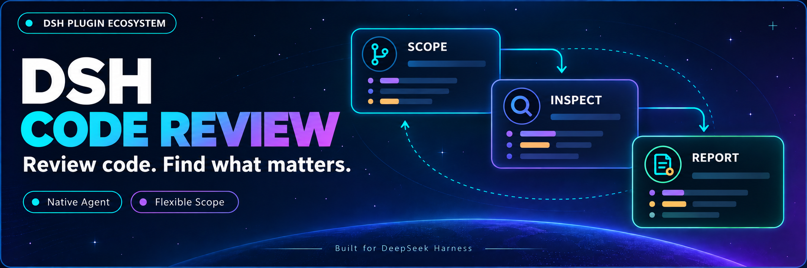

<p align="center">
  
</p>

<div align="center">

# DSH Code Review

**Запустите анализ в текущей сессии: независимый агент проверит код и предоставит отчет**

[简体中文](README.zh-CN.md) · [English](README.en.md) · [日本語](README.ja.md) · [Español](README.es.md) · [Français](README.fr.md) · [Deutsch](README.de.md) · [Русский](README.ru.md) · [Português](README.pt.md)

[Журнал изменений](CHANGELOG.md) · [Apache-2.0](LICENSE)

[](LICENSE)
[](https://github.com/MichengAI/dsh-code-review)
[](#совместимость-с-хостом)
[](https://nodejs.org/)

</div>

DSH Code Review — плагин для DeepSeek Harness (имя пакета `@michengai/dsh-code-review`). Введите `/review` в текущей сессии, выберите диапазон или опишите требования; независимый субагент самостоятельно проверит Git, исходный код, зависимости и тесты, вернув отчет в основную сессию. Установка Codex не требуется.

## Совместимость с хостом

Поддерживаемая линейка хоста: вся серия DeepSeek Harness `0.2.x` (`>=0.2.0-rc.1 <0.3.0-0`), проверено на `0.2.0-rc.1`, `0.2.0-rc.2`, `0.2.1-rc.1`～`0.2.1-rc.5`, `0.2.2-rc.1`, и автоматически поддерживается на всех последующих релизах 0.2.x RC. Ранние версии и несовместимые изменения поколения `0.3.0` блокируются версионным шлюзом. Загружается через `dsh.bundle.patch`. Требуется нативный провайдер `spawn`, служба `userQuestions`, обработчик вопросов платформы и модель с поддержкой вызова инструментов.

Установка возможна через npm или сборку из исходного кода.

## Возможности

- **Выбор диапазона анализа**: сравнение с базовой веткой, проверка незакоммиченных изменений, проверка конкретного коммита или ввод пользовательских инструкций.
- **Автономный сбор данных агентом**: считывает Git, исходный код и тесты в изолированном контексте без предварительной загрузки полного снимка репозитория.
- **Просмотр результатов в основной сессии**: получение замечаний с приоритетом, путем к файлу и номерами строк. Ответы модели в виде обычного текста сохраняются.
- **Многоязычные отчеты**: следует языковым настройкам хоста (поддержка всех 8 официальных языков) через отдельный контекст с сохранением английских спецификаций Codex.
- **Просмотр статуса или отмена**: восстановление последнего отчета или отмена выбора диапазона и текущего анализа.

## Требования к окружению

- Установленный DeepSeek Harness, команда `dsh` доступна в PowerShell.
- Node.js ≥ `22.19.0`, npm и Git; Node.js должен соответствовать требованиям установленной версии DSH.
- В примерах используется профиль `web`; замените на актуальный рабочий профиль DSH.

## Экосистема DSH

Для рабочего пространства загрузите [DSH Codex Desktop](https://github.com/MichengAI/dsh-codex-desktop/releases); при наличии установленного [DeepSeek Harness](https://github.com/deepseek-ai/deepseek-harness) устанавливайте плагины по инструкции из README:

| Плагин | Возможности |
| --- | --- |
| [Codex UI](https://github.com/MichengAI/dsh-codex-ui) | Организация проектов и сессий, поиск задач и навигация |
| [Agency Agents](https://github.com/MichengAI/dsh-agency-agents) | Выбор и вызов специализированных агентов под задачи |
| [Skills Manager](https://github.com/MichengAI/dsh-skills-manager) | Поиск, включение, создание и импорт навыков |
| [Archive Manager](https://github.com/MichengAI/dsh-archive-manager) | Поиск, восстановление и очистка архивированных сессий |
| [IM Connect](https://github.com/MichengAI/dsh-im-connect) | Отправка задач и получение ответов через мессенджеры |
| [Automation](https://github.com/MichengAI/dsh-automation) | Запуск задач по расписанию и просмотр результатов |
| [BTW](https://github.com/MichengAI/dsh-btw) | Вопросы в текущем контексте без прерывания основной задачи |
| [Simplify](https://github.com/MichengAI/dsh-simplify) | Улучшение кода в рамках изменений Git командой `/simplify` |
| [PUA](https://github.com/MichengAI/dsh-pua) | Направление агента на смену подхода при ошибках и проверка перед завершением |
| [Code Review](https://github.com/MichengAI/dsh-code-review) | Независимый анализ кода с `/review` и получение отчета |
| [Codex Pet](https://github.com/MichengAI/dsh-codex-pet) | Уведомления и подтверждения через питомца на рабочем столе |

## Установка

### Установка через агента (рекомендуется)

Отправьте следующую инструкцию агенту с доступом к локальному терминалу:

```text
Установите плагин DSH @michengai/dsh-code-review в локальный профиль web: выполните dsh plugin --profile web add @michengai/dsh-code-review@latest --registry=https://registry.npmjs.org/, затем dsh --profile web --dump-config для подтверждения загрузки, и объясните, как перезапустить DSH и использовать /review. При ошибке остановитесь и укажите причину.
```

### Ручная установка

Выполните команды:

```powershell
[Console]::OutputEncoding = [System.Text.Encoding]::UTF8
$OutputEncoding = [System.Text.Encoding]::UTF8
dsh plugin --profile web add @michengai/dsh-code-review@latest --registry=https://registry.npmjs.org/
dsh --profile web --dump-config
```

Перезапустите backend DSH и введите `/review`.

## Использование

| Цель | Команда |
| --- | --- |
| Открыть выбор диапазона | `/review` |
| Указать акценты анализа | `/review Проверить регрессии прав доступа в последнем коммите` |
| Посмотреть статус или последний отчет | `/review-status` |
| Отменить выбор или текущий анализ | `/review-cancel` |

Пустой ввод предлагает четыре варианта: сравнение с базовой веткой, проверка незакоммиченных изменений, проверка коммита или произвольные требования. Диапазон незакоммиченных изменений включает индексированные, неиндексированные и неотслеживаемые файлы. Меню базовой ветки выводит список локальных веток; меню коммитов отображает последние 100 коммитов, также можно свободно ввести любую другую ссылку.

Весь текст после команды считается пользовательской инструкцией и не анализируется как параметры CLI. Флаги вроде `--base main`, `.`, и `status` передаются обычным текстом. Диапазон анализа и требуемый контекст определяются и запрашиваются субагентом самостоятельно; запрос «проверить весь проект» передается как есть, но не означает подтвержденного пофайлового полного покрытия.

## Конфигурация и отчеты

| Параметр | Поведение |
| --- | --- |
| `reviewModel` | Модель анализа у того же провайдера; по умолчанию наследует модель сессии |
| `reportDirectory` | Абсолютный путь сохранения отчетов; по умолчанию `$DSH_HOME/code-review` или `~/.dsh/code-review` |

Язык следует настройке хоста `locale.preference`: поддерживаются все 8 официальных языков (`zh` / `en` / `ja` / `es` / `fr` / `de` / `ru` / `pt`). Считывает запись `locale`, возвращаемую `settings.describe()`. Язык фиксируется в начале каждого раунда; меню команд в интерфейсе обновляется немедленно при смене языка, а зарегистрированные сервером описания команд фиксируются при загрузке плагина. При явном выборе неподдерживаемого неофициального языка интерфейс и отчеты переключаются на английский в соответствии с поведением хоста; при отсутствии сохраненных настроек бэкенд по умолчанию использует китайский язык, а меню отражает язык, определенный фронтендом хоста.

Последний отчет каждой сессии сохраняется атомарно в формате GitHub Flavored Markdown, отображаемом в DSH. Текст исторических отчетов автоматически не переводится. Завершение работы хоста не приводит к автоматическому возобновлению незавершенных анализов.

## Часто задаваемые вопросы

### Полностью ли это идентично Codex?

Спецификация анализа и шаблоны задач соответствуют зафиксированному коммиту `a592c38c16cdd7623dacc9168926ebccedfb67d3`. Интерфейс диалога, инструменты, разрешения и события используют нативные возможности DSH; это не попиксельный клон Codex Desktop. Разные модели могут формировать разные замечания.

### Изменяет ли анализ исходный код?

Инструкции анализа не требуют внесения правок, хотя уровень инструментов не ограничен строго режимом только для чтения. Исполнение следует принципам Agency: нативный `spawn` внедряет роль рецензента с сохранением системных подсказок и инструментов хоста, блокируя лишь рекурсивный анализ и вызов экспертов. Разрешения определяются хостом при делегировании; плагин не переопределяет политики утверждения и не пересылает запросы одобрения субагента. Операции вне разрешенного диапазона отклоняются хостом, а рецензент возвращает отчет с объяснением ограничений.

Если выполнение команд Git завершается сбоем подготовки песочницы Windows или тесты завершаются с ошибкой `spawn EPERM`, родительская сессия должна устранить ограничения окружения или разрешений перед повторным запуском анализа. Статус «Завершено» означает, что агент вернул отчет; это не гарантирует полную проверку каждого diff или успешное прохождение всех тестов. Ограничения отражены в тексте отчета.

### Что делать, если после установки нет вывода?

Убедитесь, что для установки и работы используется один и тот же профиль, перезапустите backend DSH и проверьте, что `dsh --profile web --dump-config` содержит плагин. Анализ использует режим прямого вызова через команду в стиле Codex и не внедряет глобальные инструменты в основной агент (предотвращая спонтанный вызов модели во время написания кода). Для вызова `/review` без аргументов требуется только обработчик вопросов хоста для интерактивного выбора диапазона. Используйте `/review-status` для просмотра записей.

### Почему в интерфейсе может отображаться другой язык?

Явно выберите целевой язык в настройках хоста. Язык генерации модели управляется системными инструкциями, но не может быть гарантирован абсолютно. Необработанные ошибки внешних инструментов, фрагменты кода и исторические отчеты не переводятся автоматически.

## Разработка и участие

```powershell
[Console]::OutputEncoding = [System.Text.Encoding]::UTF8
$OutputEncoding = [System.Text.Encoding]::UTF8
npm ci --ignore-scripts
npm run check
npm run verify:package
dsh plugin --profile web add .\michengai-dsh-code-review-0.1.3.tgz --ignore-scripts
```

Команда `check` включает TypeScript, хэши промптов, задачи, регрессионные тесты в автономном AgentLoop и проверку ссылок документации. `verify:package` проверяет загрузку бандла, зависимости peer и интеграцию с хостом. Перед коммитом изменений запустите `npm run build`.

| Точка входа | Назначение |
| --- | --- |
| [src/index.ts](src/index.ts) | Команды и возврат отчета |
| [src/selection.ts](src/selection.ts) | Нативный выбор диапазона |
| [src/runtime.ts](src/runtime.ts) | Независимый рецензент и ограничения инструментов |
| [src/request.ts](src/request.ts) | Шаблоны задач Codex и разрешение базовых ссылок |
| [src/i18n.ts](src/i18n.ts) | Язык хоста и контекст языка вывода |
| [src/report.ts](src/report.ts) | Последовательный откат: полный JSON, частичный JSON и обычный текст |

Полная история разработки доступна в [навигации разработчика](docs/00-交接入口/00-阅读导航.md). Для отката переустановите предыдущий локальный пакет и перезапустите DSH. Сессии и отчеты не удаляются.

## Источники и лицензия

Выпущено под лицензией [Apache License 2.0](LICENSE). См. [rubric](assets/codex/review/rubric.md), [source.json](assets/codex/review/source.json) и [NOTICE](NOTICE).

Исходный код: [Шаблоны задач](https://github.com/openai/codex/blob/a592c38c16cdd7623dacc9168926ebccedfb67d3/codex-rs/prompts/src/review_request.rs) · [Исполнение анализа](https://github.com/openai/codex/blob/a592c38c16cdd7623dacc9168926ebccedfb67d3/codex-rs/core/src/tasks/review.rs) · [Выбор диапазона](https://github.com/openai/codex/blob/a592c38c16cdd7623dacc9168926ebccedfb67d3/codex-rs/tui/src/chatwidget/review_popups.rs) · [Базовые ветки](https://github.com/openai/codex/blob/a592c38c16cdd7623dacc9168926ebccedfb67d3/codex-rs/git-utils/src/branch.rs).
